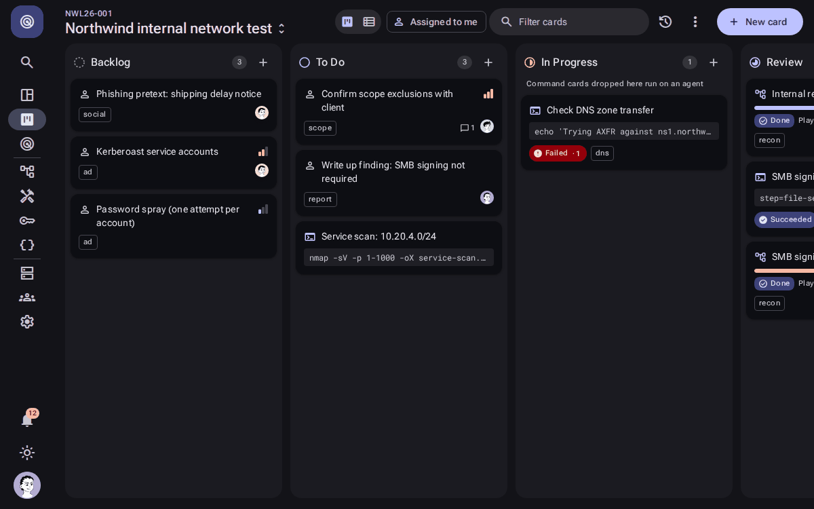
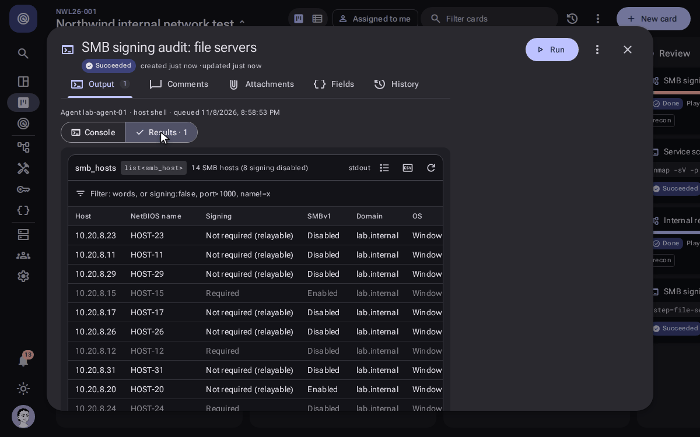
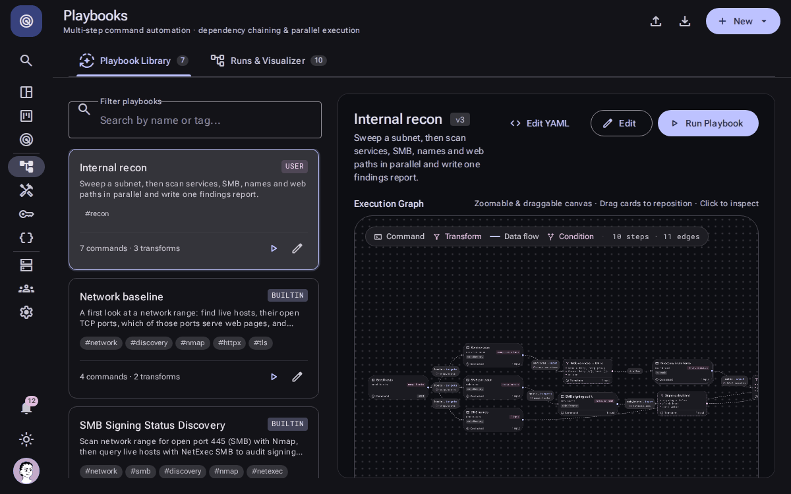
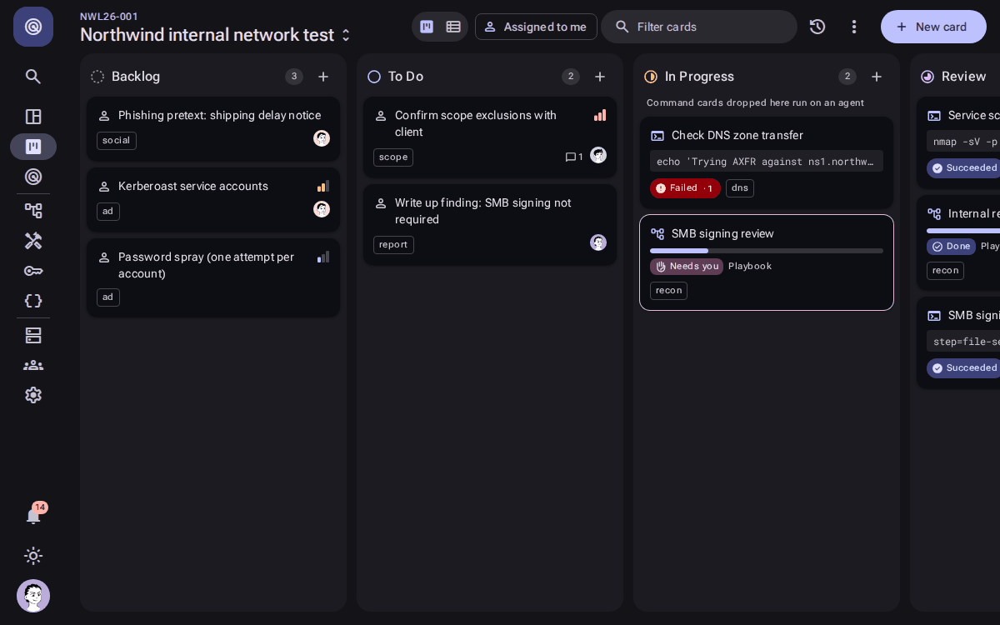

<p align="center">
  <picture>
    <source media="(prefers-color-scheme: light)" srcset=".github/assets/banner-light.svg">
    
  </picture>
</p>

<p align="center">
  <a href="https://github.com/emilyastranova/castor/wiki"><b>Documentation</b></a>
  &nbsp;·&nbsp;
  <a href="https://github.com/emilyastranova/castor/wiki/Installation">Install</a>
  &nbsp;·&nbsp;
  <a href="docs/PLAYBOOK_SPEC.md">Playbook spec</a>
  &nbsp;·&nbsp;
  <a href="docs/ARCHITECTURE.md">Architecture</a>
  &nbsp;·&nbsp;
  <a href="docs/ARCHITECTURE.md#roadmap">Roadmap</a>
  &nbsp;·&nbsp;
  <a href="LICENSE">MIT</a>
</p>

<p align="center">
  
  
  
  <a href="LICENSE"></a>
</p>

Castor is a Kanban board that runs your automation. Cards on a project board are
either **manual tasks** for people or **command tasks** for agents. Drag a command
card into *In Progress* and Castor dispatches it to an agent, which runs it in a
container and streams the output straight back into the card. Parsers turn the
tool's output into typed results (hosts, services, URLs), so the board doubles as
the workflow's execution log, and what they find becomes the project's **assets**: one
record per host, service or URL that every tool adds to, with triggers that act on new ones.

**Playbooks** chain commands into a graph. Steps run in parallel where they can,
transform steps reshape one tool's results into the next tool's input, and a run shows
on the board as one card that opens into its live graph, decisions and steps.

## See it work

**Drag a command card into In Progress.** An agent picks it up, the output streams into the
card, and the parser turns it into a table of hosts and services.

<p align="center"></p>

**Ask the results a question.** Every parsed table filters and sorts: here, the hosts that don't
require SMB signing, by name.

<p align="center"></p>

**Chain it into a playbook.** Steps run in parallel where they can, transforms reshape one tool's
results into the next tool's input, and the graph fills in live.

<p align="center"></p>

**Decide when it matters.** A step can stop and ask. Pick what happens, add a note, and the
playbook takes the branch that handles it.

<p align="center"></p>

## Features

**Run the work**
- **Command cards that run themselves.** Drag a card into *In Progress* and an agent runs it in a
  container or the host shell, streaming output live into the card. ([Cards](https://github.com/emilyastranova/castor/wiki/Cards))
- **Interactive terminals.** Take control of a running job and type into it (tmux, vim, sudo
  prompts); Castor alerts people when an unattended job stops at a prompt. ([Jobs and Output](https://github.com/emilyastranova/castor/wiki/Jobs-and-Output))
- **Playbooks.** Chain commands into a graph with parallel branches, transforms between steps,
  conditions, and steps that pause for a decision. A run is one card with a live graph. ([Playbooks](https://github.com/emilyastranova/castor/wiki/Playbooks))
- **Lightweight agents.** One Python dependency; tools are pulled or built on demand, per-agent
  tokens, tags to route work to the right machine. ([Agents](https://github.com/emilyastranova/castor/wiki/Agents))

**Make sense of the output**
- **Parsed results.** nmap, NetExec, ffuf, httpx and more become typed tables you can filter
  (`signing:false`), sort and copy as CSV. ([Jobs and Output](https://github.com/emilyastranova/castor/wiki/Jobs-and-Output))
- **Your own parsers.** Write one in YAML (regex, JSON, CSV, XML…) or sandboxed JavaScript, with
  live test input and a built-in reference. ([Parsers](https://github.com/emilyastranova/castor/wiki/Parsers))
- **Assets.** Every host, service, URL and credential your jobs find, merged into one inventory,
  with triggers that act on new ones and lists you feed back into commands. ([Assets](https://github.com/emilyastranova/castor/wiki/Assets))

**The command library**
- **Ready-made commands** for nmap, NetExec, httpx, Nuclei, ffuf, testssl.sh, ssh-audit,
  subfinder, dnsx, Trivy and curl, plus five built-in playbooks. Each command is a YAML file that
  wraps a command line with typed arguments, the tool it runs in, and the outputs to parse. ([Commands](https://github.com/emilyastranova/castor/wiki/Commands))
- **Quoted arguments, vaulted secrets.** Argument values are shell-quoted into the command line; credentials live in an encrypted vault and
  reach jobs only as environment variables and files, with secrets masked if a tool prints them. ([Variables and the Vault](https://github.com/emilyastranova/castor/wiki/Variables-and-the-Vault))
- **Import and export** projects and library items between instances. ([Import and Export](https://github.com/emilyastranova/castor/wiki/Import-and-Export))

**AI where it helps** ([AI](https://github.com/emilyastranova/castor/wiki/AI))
- Any LLM provider, with fallback chains. AI can resolve a failed step, draft a parser for output
  nobody has seen before (even mid-playbook), explain failures and generate commands and playbooks.
  Changes it makes to commands wait for a person by default.

**Work as a team**
- **Live everywhere.** Every open browser updates as things happen, no refresh: cards glide to
  their new column when someone else moves them, job output streams into the console, playbook
  graphs fill in step by step, and comments, notifications, agents and new assets appear as
  they arrive. ([Projects and Boards](https://github.com/emilyastranova/castor/wiki/Projects-and-Boards))
- **Roles and projects.** Viewers, operators and admins; members per project. ([People and Notifications](https://github.com/emilyastranova/castor/wiki/People-and-Notifications))
- **@mentions, assignees and an inbox**, plus chat and webhook **alerts** for finished runs,
  decisions and long-running jobs. ([Alerts](https://github.com/emilyastranova/castor/wiki/Alerts))
- **A project Home** with pinned notes, today's numbers and what needs you. ([Projects and Boards](https://github.com/emilyastranova/castor/wiki/Projects-and-Boards))
- **Board or list view**, search everything with Ctrl/Cmd+K, and a phone layout good enough to
  check a run and answer a decision one-handed. ([Using Castor on a Phone](https://github.com/emilyastranova/castor/wiki/Using-Castor-on-a-Phone))

**Connect other software**
- **REST API with scoped tokens** and a reference at `/api/docs`. ([API and Tokens](https://github.com/emilyastranova/castor/wiki/API-and-Tokens))
- **Built-in MCP server** so Claude, Gemini CLI, VS Code and other assistants can work with your
  boards, runs and assets. ([MCP Server](https://github.com/emilyastranova/castor/wiki/MCP-Server))

## A look around

<p align="center">
  
</p>

You work in one project at a time (pick it once; Castor remembers it). Its Home is the
dashboard: what changed, what's running, and what's waiting on you (mentions, playbook
decisions, failed runs, jobs at a prompt). The Inbox covers every project.

<table>
  <tr>
    <td width="50%"></td>
    <td width="50%"></td>
  </tr>
  <tr>
    <td><b>The board.</b> Manual and command cards; dragging a command card into In
    Progress runs it on an agent.</td>
    <td><b>A playbook run</b> is one card: its progress, decisions to answer and the live
    graph; each step opens as its own card with its console and results.</td>
  </tr>
  <tr>
    <td colspan="2"></td>
  </tr>
  <tr>
    <td colspan="2"><b>Playbooks.</b> A run drawn as a graph: commands, the transforms
    between them, and each step's status and outputs.</td>
  </tr>
  <tr>
    <td colspan="2"></td>
  </tr>
  <tr>
    <td colspan="2"><b>Assets.</b> Every host, service, URL and credential your jobs find,
    merged into one inventory you can filter and feed back into commands; shown here in the
    light theme.</td>
  </tr>
  <tr>
    <td colspan="2"></td>
  </tr>
  <tr>
    <td colspan="2"><b>On a phone</b>, a bottom bar replaces the rail, so checking a run or
    answering a decision works one-handed.</td>
  </tr>
</table>

---

## How it works

<p align="center">
  <picture>
    <source media="(prefers-color-scheme: light)" srcset=".github/assets/architecture-light.svg">
    
  </picture>
</p>

1. A command card names a command from the **library**: a YAML definition with
   typed arguments, an optional container image, and the outputs to collect.
2. When the card enters *In Progress*, the server queues a **job**. The
   dispatcher sends it to a connected agent that matches the card's tags and has
   the runtime the job needs.
3. The **agent** runs the job in its own `/work` directory, inside a container
   or in the host shell, and streams stdout and stderr back to the card as it
   runs.
4. After the job, the agent uploads the declared output files. The server
   **parses** them (nmap XML, NetExec, ffuf JSON, lines, regex) into typed
   results that show on the card.

Argument values are shell-quoted when the command line is rendered, credentials reach the
job as environment variables and files rather than in the command, and a card can run under a
real terminal you take control of. The [wiki](https://github.com/emilyastranova/castor/wiki) covers all of it.

## Playbooks

<p align="center">
  <picture>
    <source media="(prefers-color-scheme: light)" srcset=".github/assets/playbook-light.svg">
    
  </picture>
</p>

A playbook is a YAML graph of steps. **Command steps** run on agents; **transform steps** run
on the server and reshape one step's results into the next step's input. Steps that don't
depend on each other run at the same time, branches can depend on conditions, and a step can
pause for a person (or AI) to decide what happens next. Read the
[Playbooks guide](https://github.com/emilyastranova/castor/wiki/Playbooks), or [docs/PLAYBOOK_SPEC.md](docs/PLAYBOOK_SPEC.md), the
self-contained authoring spec you can hand to an agent that writes playbooks.

### What's included

Each command runs in its own tool container, pulled or built on an agent the first time it's
needed, so agents stay bare.

| Area | Commands (tool) |
| --- | --- |
| Network discovery | Ping sweep, top TCP ports, UDP scan, service/version scan, SMB port 445 (nmap) |
| Web | Web probe with titles and technologies (httpx), vulnerability scan (Nuclei), directory brute force with SecLists (ffuf), security headers (curl) |
| TLS and SSH | TLS configuration scan (testssl.sh), certificate expiry (nmap), SSH configuration audit (ssh-audit) |
| DNS and recon | Passive subdomain discovery (subfinder), name resolution (dnsx) |
| Windows / SMB | SMB signing and host info, authenticated checks over any protocol, share listing (NetExec) |
| Containers and ops | Image vulnerability scan (Trivy) |

Built-in playbooks: **Network baseline**, **Web attack surface**, **TLS review**, **SMB signing
discovery** and **SSH version discovery**. Add your own [commands](https://github.com/emilyastranova/castor/wiki/Commands),
[tools](https://github.com/emilyastranova/castor/wiki/Tools) and [parsers](https://github.com/emilyastranova/castor/wiki/Parsers) in the Library.

## Quick start

With Docker or Podman Compose:

```bash
cp .env.example .env     # edit the secrets
docker compose up -d --build
```

Open <http://localhost:8080> and sign in with the admin credentials from `.env`. Add
`--profile agent` to also run an agent inside the stack; [Agents](https://github.com/emilyastranova/castor/wiki/Agents) shows how to connect one on
another host. [Installation](https://github.com/emilyastranova/castor/wiki/Installation) covers upgrades, backups, a lost admin
password and running from source.

## Documentation

The [wiki](https://github.com/emilyastranova/castor/wiki) is the manual:

- **Running Castor:** [Installation](https://github.com/emilyastranova/castor/wiki/Installation), [Agents](https://github.com/emilyastranova/castor/wiki/Agents),
  [Configuration](https://github.com/emilyastranova/castor/wiki/Configuration), [Security](https://github.com/emilyastranova/castor/wiki/Security),
  [Troubleshooting](https://github.com/emilyastranova/castor/wiki/Troubleshooting)
- **Using it:** [Projects and Boards](https://github.com/emilyastranova/castor/wiki/Projects-and-Boards), [Cards](https://github.com/emilyastranova/castor/wiki/Cards),
  [Jobs and Output](https://github.com/emilyastranova/castor/wiki/Jobs-and-Output), [People and Notifications](https://github.com/emilyastranova/castor/wiki/People-and-Notifications),
  [Assets](https://github.com/emilyastranova/castor/wiki/Assets), [Search and Shortcuts](https://github.com/emilyastranova/castor/wiki/Search-and-Shortcuts),
  [On a phone](https://github.com/emilyastranova/castor/wiki/Using-Castor-on-a-Phone)
- **The library:** [Commands](https://github.com/emilyastranova/castor/wiki/Commands), [Tools](https://github.com/emilyastranova/castor/wiki/Tools),
  [Parsers](https://github.com/emilyastranova/castor/wiki/Parsers), [Variables and the Vault](https://github.com/emilyastranova/castor/wiki/Variables-and-the-Vault)
- **Automation:** [Playbooks](https://github.com/emilyastranova/castor/wiki/Playbooks), [AI](https://github.com/emilyastranova/castor/wiki/AI), [Alerts](https://github.com/emilyastranova/castor/wiki/Alerts),
  [API and Tokens](https://github.com/emilyastranova/castor/wiki/API-and-Tokens), [MCP Server](https://github.com/emilyastranova/castor/wiki/MCP-Server),
  [Import and Export](https://github.com/emilyastranova/castor/wiki/Import-and-Export)

Contributors: [running from source](https://github.com/emilyastranova/castor/wiki/Installation#running-from-source-development) has the
dev setup, tests and checks; [docs/ARCHITECTURE.md](docs/ARCHITECTURE.md) has the data model, events and the agent
protocol.

## Repository

| Path | Contents |
|---|---|
| [`web/`](web/) | SvelteKit UI with a Material 3 design system |
| [`server/`](server/) | FastAPI API, UI WebSocket, agent gateway, dispatcher, parsers, playbook engine (SQLite or PostgreSQL) |
| [`agent/`](agent/) | The agent: runs jobs in podman/docker containers or the host shell |
| [`tools/`](tools/) | Built-in tool environments (YAML): images or build recipes commands run in |
| [`commands/`](commands/) | Built-in command definitions (YAML). Format in [`commands/README.md`](commands/README.md) |
| [`playbooks/`](playbooks/) | Built-in playbooks (YAML). Format in [`docs/PLAYBOOK_SPEC.md`](docs/PLAYBOOK_SPEC.md) |
| [`docs/`](docs/) | [Architecture](docs/ARCHITECTURE.md), agent protocol and roadmap, [playbook spec](docs/PLAYBOOK_SPEC.md) |
| [`deploy/`](deploy/) | Caddy reverse-proxy configuration for `compose.yaml` |
| [`.github/assets/`](.github/assets/) | README images, made by `build_assets.py` from the AstraLabs brand files |

## License

Castor is released under the MIT License; see [LICENSE](LICENSE).

The AstraLabs name, mark, and wordmark identify the work of Emily Astranova.
The MIT License does not give trademark rights to them.

---

<p align="center">
  <a href="https://astralabs.dev"></a>
</p>
