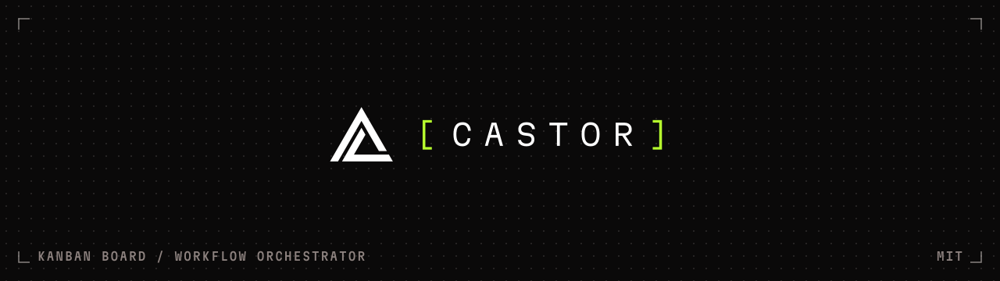
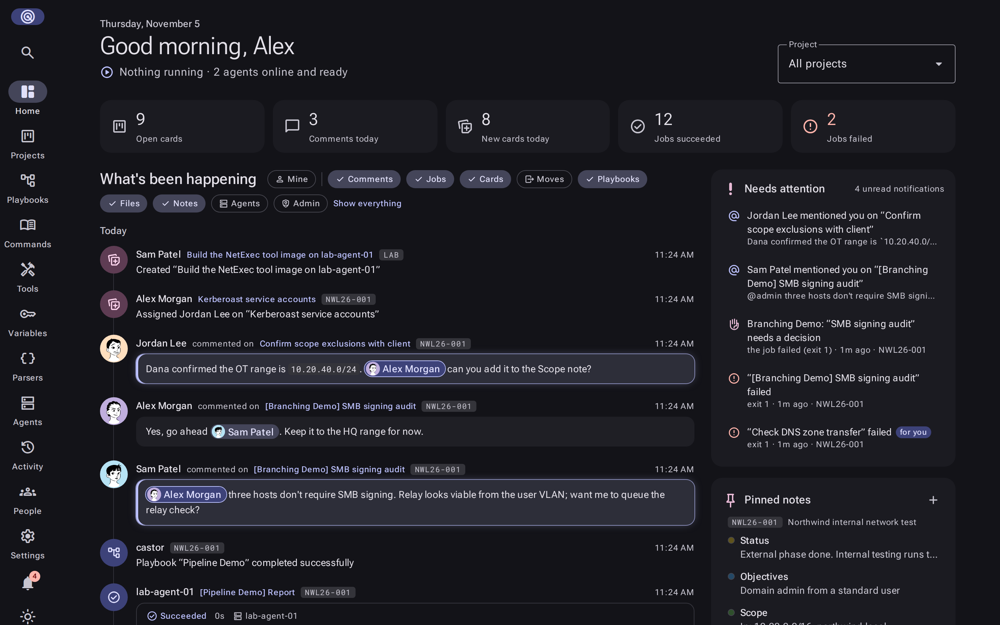
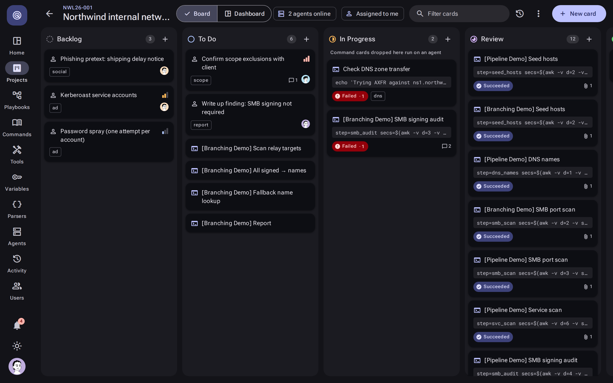
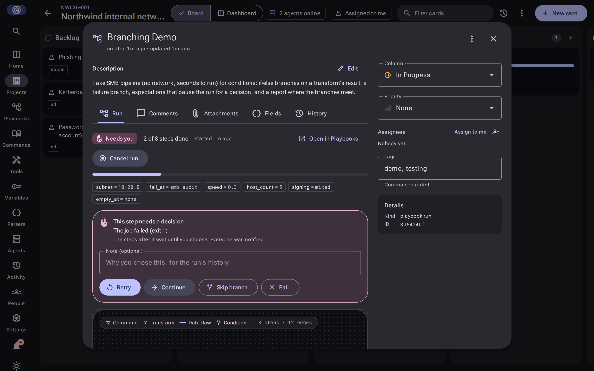
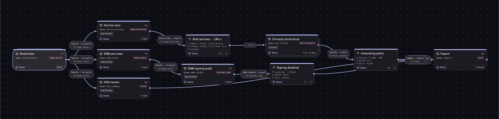
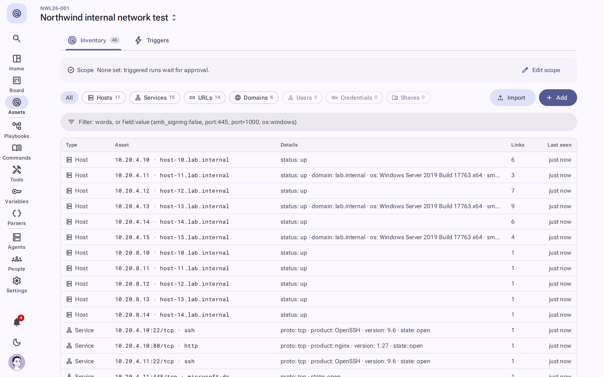
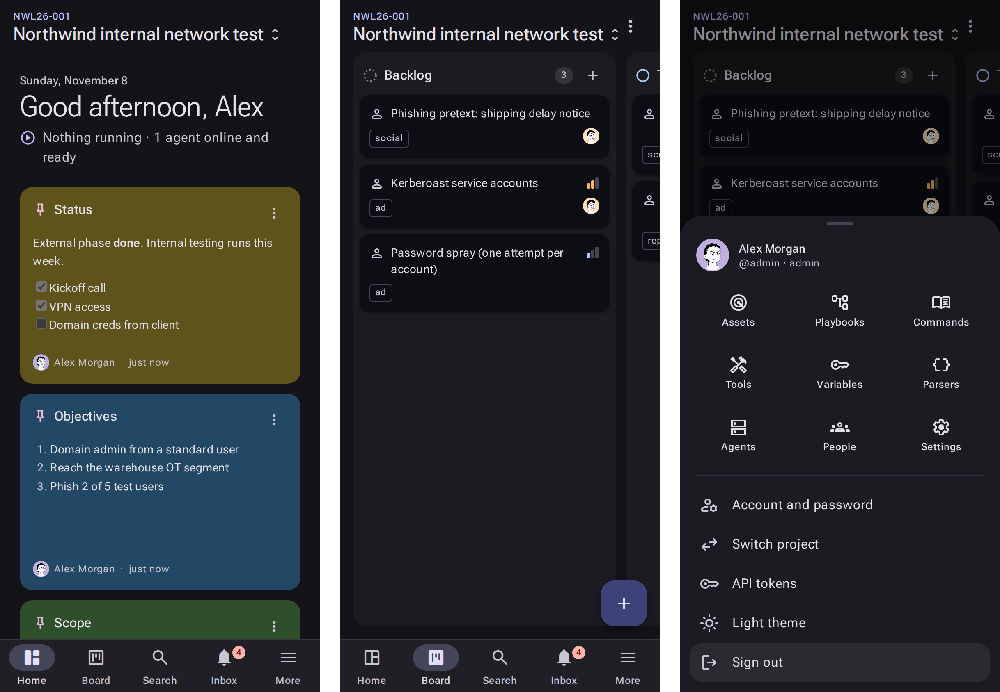
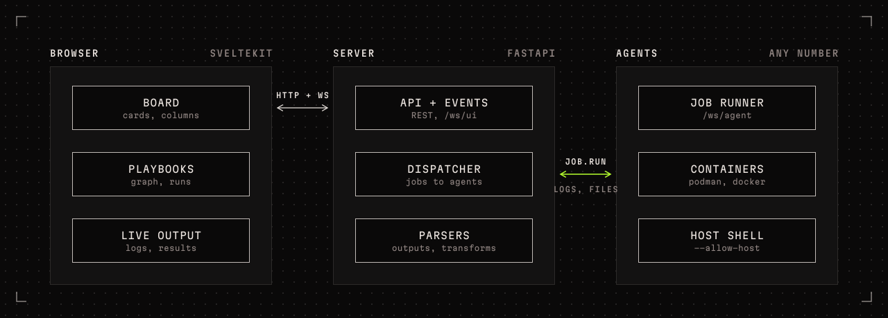
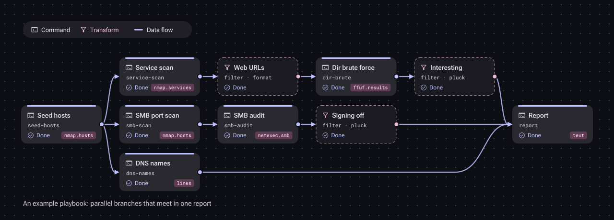

<p align="center">
  <picture>
    <source media="(prefers-color-scheme: light)" srcset=".github/assets/banner-light.svg">
    
  </picture>
</p>

<p align="center">
  <a href="docs/ARCHITECTURE.md"><b>Architecture</b></a>
  &nbsp;·&nbsp;
  <a href="docs/PLAYBOOK_SPEC.md">Playbook spec</a>
  &nbsp;·&nbsp;
  <a href="commands/README.md">Commands</a>
  &nbsp;·&nbsp;
  <a href="docs/PHASE4.md">Roadmap</a>
  &nbsp;·&nbsp;
  <a href="LICENSE">MIT</a>
</p>

<p align="center">
  
  
  
  <a href="LICENSE"></a>
</p>

Castor is a Kanban board that runs your automation. Cards on a project board are
either **manual tasks** for people or **command tasks** for agents. Drag a command
card into *In Progress* and Castor dispatches it to an agent, which runs it in a
container and streams the output straight back into the card. Parsers turn the
tool's output into typed results (hosts, services, URLs), so the board doubles as
the workflow's execution log, and what they find becomes the project's **assets**: one
record per host, service or URL that every tool adds to, with triggers that act on new ones.

**Playbooks** chain commands into a graph. Steps run in parallel where they can,
transform steps reshape one tool's results into the next tool's input, and a run shows
on the board as one card that opens into its live graph, decisions and steps.

> **■ Status: Phase 4 in progress.** Phases 2 and 3 are done (the board, agents, command
> library, parsers, playbooks, users and roles; then tool environments, @mentions, AI help,
> assets, search, interactive terminals, chat alerts and more): see
> [docs/PHASE2.md](docs/PHASE2.md) and [docs/PHASE3.md](docs/PHASE3.md). Phase 4 has added
> scoped API tokens, an API reference at `/api/docs` and a built-in MCP server for AI
> assistants ([docs/PHASE4.md](docs/PHASE4.md)).

## A look around

<p align="center">
  
</p>

You work in one project at a time (pick it once; Castor remembers it). Its Home is the
dashboard: what changed, what's running, and what's waiting on you (mentions, playbook
decisions, failed runs, jobs at a prompt). The Inbox covers every project.

<table>
  <tr>
    <td width="50%"></td>
    <td width="50%"></td>
  </tr>
  <tr>
    <td><b>The board.</b> Manual and command cards; dragging a command card into In
    Progress runs it on an agent.</td>
    <td><b>A playbook run</b> is one card: its progress, decisions to answer and the live
    graph; each step opens as its own card with its console and results.</td>
  </tr>
  <tr>
    <td colspan="2"></td>
  </tr>
  <tr>
    <td colspan="2"><b>Playbooks.</b> A run drawn as a graph: commands, the transforms
    between them, and each step's status and outputs.</td>
  </tr>
  <tr>
    <td colspan="2"></td>
  </tr>
  <tr>
    <td colspan="2"><b>Assets.</b> Every host, service, URL and credential your jobs find,
    merged into one inventory you can filter and feed back into commands; shown here in the
    light theme.</td>
  </tr>
  <tr>
    <td colspan="2"></td>
  </tr>
  <tr>
    <td colspan="2"><b>On a phone</b>, a bottom bar replaces the rail, so checking a run or
    answering a decision works one-handed.</td>
  </tr>
</table>

---

## How it works

<p align="center">
  <picture>
    <source media="(prefers-color-scheme: light)" srcset=".github/assets/architecture-light.svg">
    
  </picture>
</p>

1. A command card names a command from the **library**: a YAML definition with
   typed arguments, an optional container image, and the outputs to collect.
2. When the card enters *In Progress*, the server queues a **job**. The
   dispatcher sends it to a connected agent that matches the card's tags and has
   the runtime the job needs.
3. The **agent** runs the job in its own `/work` directory, inside a container
   or in the host shell, and streams stdout and stderr back to the card as it
   runs.
4. After the job, the agent uploads the declared output files. The server
   **parses** them (nmap XML, NetExec, ffuf JSON, lines, regex) into typed
   results that show on the card.

Castor shell-quotes every argument value when it renders the command line, so a value
stays one shell word and can't inject shell syntax.

Mark a card **Interactive terminal** and its job runs under a real terminal: you can take
control from the card and type into it (tmux, vim and sudo prompts work), and Castor alerts
people when an unattended run stops at a prompt.

## Playbooks

<p align="center">
  <picture>
    <source media="(prefers-color-scheme: light)" srcset=".github/assets/playbook-light.svg">
    
  </picture>
</p>

A playbook is a YAML graph of steps. **Command steps** become cards and run on
agents. **Transform steps** run on the server between commands: they filter,
pluck, format, de-duplicate, sort or limit the previous step's results. A step
that references another step's output waits for it, and steps that don't depend
on each other run at the same time.

```yaml
steps:
  - id: sweep
    name: Ping sweep
    command_ref: nmap-ping-sweep
    args: { targets: "{{ inputs.targets }}" }

  - id: live
    name: Live hosts
    transform:
      input: "{{ steps.sweep.outputs.hosts }}"
      ops:
        - filter: { field: status, equals: up }
        - pluck: ip
      output: { name: ips }

  - id: services
    name: Service scan
    command_ref: nmap-service-scan
    skip_if_empty: true
    args: { targets: "{{ steps.live.outputs.ips }}" }
```

The Playbooks page draws the graph live: step status, item counts on each edge,
and the parsed results of every step. If a step fails, only the steps that
depend on it are blocked; the other branches finish. Re-run the failed card to
continue the run.

- [docs/PLAYBOOK_SPEC.md](docs/PLAYBOOK_SPEC.md) is the complete authoring spec.
  It is self-contained, so you can give it to an agent that writes playbooks.
- `POST /api/playbooks/validate` checks a playbook against the command library
  without saving it.
- Built-in playbooks: **Network baseline** (live hosts, open ports, web services,
  certificate expiry), **Web attack surface** (subdomains, live sites, Nuclei findings,
  security headers), **TLS review**, **SMB signing discovery** and **SSH version discovery**.

### What's included

Each command runs in its own tool container, pulled or built on an agent the first time it's
needed, so agents stay bare.

| Area | Commands (tool) |
| --- | --- |
| Network discovery | Ping sweep, top TCP ports, UDP scan, service/version scan, SMB port 445 (nmap) |
| Web | Web probe with titles and technologies (httpx), vulnerability scan (Nuclei), directory brute force with SecLists (ffuf), security headers (curl) |
| TLS and SSH | TLS configuration scan (testssl.sh), certificate expiry (nmap), SSH configuration audit (ssh-audit) |
| DNS and recon | Passive subdomain discovery (subfinder), name resolution (dnsx) |
| Windows / SMB | SMB signing and host info, authenticated checks over any protocol, share listing (NetExec) |
| Containers and ops | Image vulnerability scan (Trivy) |

Parsed results (hosts, services, URLs from nmap, httpx, ffuf and NetExec) become the
project's assets.

## Variables

Credentials, SSH keys, listener addresses and API keys live on the **Variables** page as
typed *sets* (one *kind* per shape of data; make your own kinds for anything else). A
command declares what it needs:

```yaml
vars:
  - name: creds
    kind: credential
command: nxc smb {{ targets }} -u {{ creds.username }} -p {{ creds.password }}
```

and the card or playbook run picks a set. Values stay out of the command line and the job
history: Castor encrypts secrets and files at rest, sends them only to the agent running
the job (as environment variables and 0600 files it deletes afterwards), and masks them in
the output if the tool prints them. See [commands/README.md](commands/README.md#variable-sets-credentials-keys-listeners-).

## API

The UI uses the same REST API you can. Make a personal token under your account menu
(**API tokens**), pick its scopes and, if you like, the projects it may touch, then send it
as `Authorization: Bearer castor_pat_…`. A token acts as you with only the access you gave
it, and it can't make other tokens or change your password. Every endpoint, with the scope
it needs, is in the reference at `/api/docs`.

```bash
curl -H "Authorization: Bearer $CASTOR_TOKEN" https://castor.example.internal/api/projects
```

AI assistants that speak MCP (Claude, Gemini CLI, VS Code…) connect to `/api/mcp` with the
same kind of token and get the tools its scopes allow: search, boards, cards, runs, job
output, playbooks and assets. The API tokens page has the setup for each. Clients that only
speak stdio (Claude Desktop) use `castor-mcp`, which `pip install ./agent` installs.

## Quick start

With Docker or Podman Compose:

```bash
cp .env.example .env     # edit the secrets
docker compose up -d --build
```

Open <http://localhost:8080> and log in with the admin credentials from `.env`.
Add `--profile agent` to also run an agent inside the stack.

Add more people under **Users** (admins only). Each person is a **viewer** (read-only),
**operator** (works in their projects and edits the command, playbook and variable
libraries) or **admin** (everything). Admins see every project; everyone else sees the
projects they're a member of (a project's **Members**). Everyone can set a profile picture
(upload, image URL or Gravatar) under their account menu; admins can set anyone's.

### Locked out?

Castor always keeps one active admin: the last one can't be demoted or disabled, and if a
database ever has none, the server makes its longest-standing user an admin when it
starts. A lost password is reset from the server's shell:

```bash
docker compose exec server castor-admin reset-password admin    # compose
.venv/bin/castor-admin reset-password admin                     # dev checkout
```

`castor-admin` also has `list-users`, `enable`, `promote` and `create-admin`.

### Upgrading

The server applies database migrations when it starts. Back up first:

```bash
# Compose (Postgres)
docker compose exec -T db pg_dump -U castor castor > castor-$(date +%F).sql
git pull && docker compose up -d --build
# to restore: docker compose exec -T db psql -U castor castor < castor-YYYY-MM-DD.sql
```

The server copies a SQLite database to `data/backups/` before it runs migrations.
Upgrading to roles keeps everyone's access: users who were admins stay admins, everyone
else becomes an operator, and every existing user becomes a member of every existing
project.

## Development

Python 3.12+ and Node 22+. One virtualenv at the repository root serves both
Python packages.

```bash
python3 -m venv .venv
.venv/bin/pip install -e "./server[dev]" -e "./agent[dev]"
(cd web && npm install)
```

Run the three parts in separate terminals. Start the API first:

```bash
.venv/bin/castor-server                 # API on :8000, SQLite in ./data
```

```bash
cd web && npm run dev                   # UI on :5173, proxies /api and /ws to :8000
```

```bash
.venv/bin/castor-agent --secret change-me-agent-secret --name dev-agent \
                       --allow-host --max-concurrency 4
```

Log in as `admin` / `castor` (from `CASTOR_ADMIN_*`, created on first start).
The server applies database migrations on startup. Server settings are
environment variables prefixed `CASTOR_` (see `server/castor_server/config.py`).
Agent flags are listed by `castor-agent --help`.

| Check | Command |
|---|---|
| Server tests | `.venv/bin/python -m pytest server/tests` |
| Agent tests | `.venv/bin/python -m pytest agent/tests` |
| Lint | `.venv/bin/ruff check server/castor_server agent/castor_agent` |
| Type check (UI) | `cd web && npm run check` |
| Production build (UI) | `cd web && npm run build` |

## Run an agent on a real host

Create a token for it on the **Agents** page (**Enroll agent**). It's shown once, and the
dialog gives you the command:

```bash
pip install ./agent
castor-agent --server wss://castor.example.internal/ws/agent \
             --token <token> --name jumpbox-1 --tags internal,linux \
             --workdir /opt/castor-work
```

You can rotate or revoke each agent's token on its own, which disconnects that agent at
once. The shared `--secret <CASTOR_AGENT_SECRET>` still works for quick setups until you set
`CASTOR_ALLOW_SHARED_AGENT_SECRET=false`.

The agent's only dependency is `websockets`, so it installs on almost any host
with Python 3.10 or later.

- With podman or docker present, command cards that name an `image` or a `tool` run
  inside that image with `--network host`. The agent pulls or builds tool images on
  demand, so the agent itself stays bare.
- Each job gets its own directory under `--workdir` (a temp directory by
  default), mounted at `/work`. The agent uploads files under `/work/artifacts/` and
  the command's declared outputs to the card.
- Cards without an image run in the agent's shell. Disable that with
  `--no-allow-host`.
- `--tags` lets a card send its work to specific agents.

## Repository

| Path | Contents |
|---|---|
| [`web/`](web/) | SvelteKit UI with a Material 3 design system |
| [`server/`](server/) | FastAPI API, UI WebSocket, agent gateway, dispatcher, parsers, playbook engine (SQLite or PostgreSQL) |
| [`agent/`](agent/) | The agent: runs jobs in podman/docker containers or the host shell |
| [`tools/`](tools/) | Built-in tool environments (YAML): images or build recipes commands run in |
| [`commands/`](commands/) | Built-in command definitions (YAML). Format in [`commands/README.md`](commands/README.md) |
| [`playbooks/`](playbooks/) | Built-in playbooks (YAML). Format in [`docs/PLAYBOOK_SPEC.md`](docs/PLAYBOOK_SPEC.md) |
| [`docs/`](docs/) | [Architecture](docs/ARCHITECTURE.md) and agent protocol, [Phase 2](docs/PHASE2.md), [Phase 3](docs/PHASE3.md) and [Phase 4](docs/PHASE4.md) plans, [playbook spec](docs/PLAYBOOK_SPEC.md) |
| [`deploy/`](deploy/) | Caddy reverse-proxy configuration for `compose.yaml` |
| [`.github/assets/`](.github/assets/) | README images, made by `build_assets.py` from the AstraLabs brand files |

## License

Castor is released under the MIT License; see [LICENSE](LICENSE).

The AstraLabs name, mark, and wordmark identify the work of Emily Astranova.
The MIT License does not give trademark rights to them.

---

<p align="center">
  <a href="https://astralabs.dev"></a>
</p>
